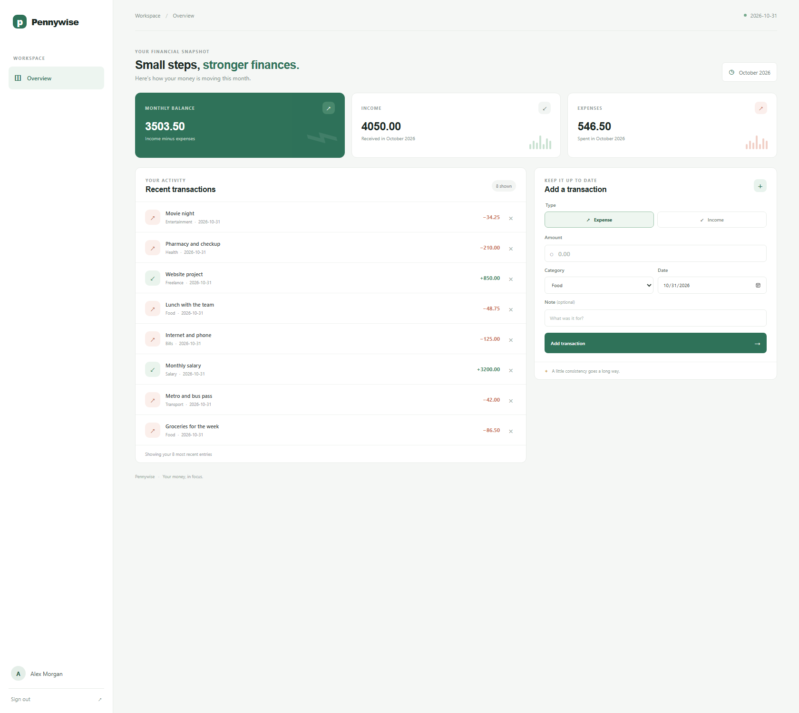
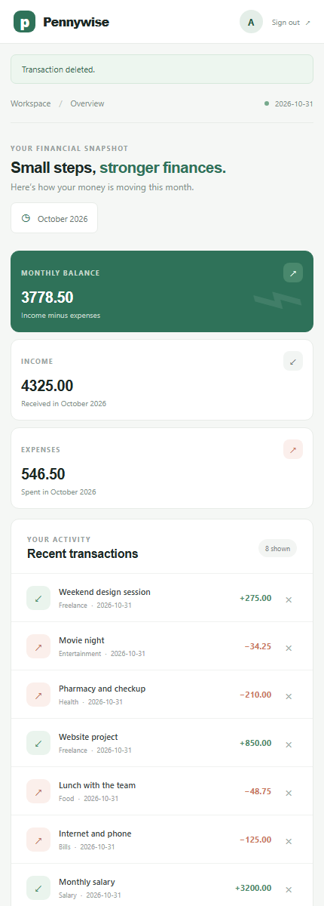

# Pennywise

### Your money, in focus.

Pennywise is a clean, responsive expense tracker for keeping everyday income and spending in view. Create an account, record transactions, and see how this month is shaping up at a glance.



<p align="center">
  <strong>Flask</strong> · <strong>SQLite</strong> · <strong>Python 3.10+</strong>
</p>

## What you can do

- **See your monthly snapshot** — income, expenses, and balance for the current month.
- **Keep a transaction log** — add income or expenses with a category, date, and optional note.
- **Review recent activity** — find your eight latest transactions and remove entries you no longer need.
- **Keep accounts separate** — registration and sign-in protect each user's transaction records.
- **Use it on any screen** — a responsive interface works across desktop and mobile.

## A look inside

| Monthly dashboard | Add an expense | Mobile layout |
|:--:|:--:|:--:|
|  |  |  |

Browse the [complete screenshot gallery](docs/screenshots/README.md) for registration, sign-in, categories, transaction updates, and more.

## Run locally

**You’ll need** Python 3.10 or later.

```powershell
python -m venv .venv
.\.venv\Scripts\Activate.ps1
python -m pip install -r requirements.txt
$env:SECRET_KEY = (python -c "import secrets; print(secrets.token_hex(32))")
python app.py
```

Open [http://127.0.0.1:5000](http://127.0.0.1:5000). On first run, Pennywise creates its SQLite database at `instance/expense_tracker.sqlite3`.

To use another database location, set `DATABASE` before starting the app. If `SECRET_KEY` is not set in development, a temporary random key is generated at startup; sessions will expire when the process restarts. Production requirements are described below.

## Production deployment

Pennywise refuses to start in production unless `SECRET_KEY` is set to a persistent value of at least 32 bytes. Generate it once (for example, with `python -c "import secrets; print(secrets.token_hex(32))"`) and save it in your hosting provider's secret manager; do not generate a new key at each restart.

Set these environment variables in the hosting service:

| Variable | Required value |
|:--|:--|
| `APP_ENV` | `production` |
| `SECRET_KEY` | Persistent secret, at least 32 bytes |
| `DATABASE` | Optional path to the SQLite database on a persistent disk |
| `TRUSTED_PROXY_HOPS` | Optional number of trusted reverse-proxy hops; default `0` |

Production always sets the session cookie's `Secure`, `HttpOnly`, and `SameSite=Lax` attributes. `COOKIE_SECURE=0` is rejected in production; `COOKIE_SECURE=1` is available only as an opt-in for local HTTPS development. Terminate TLS at your hosting platform's HTTPS ingress/load balancer and configure that ingress to redirect HTTP traffic to HTTPS. The app does not infer HTTPS from forwarded headers unless `TRUSTED_PROXY_HOPS` is explicitly set. Set it only when the trusted proxy overwrites `X-Forwarded-Proto`, and use the exact number of trusted hops; otherwise leave it at `0`.

Install dependencies and run the WSGI app with Gunicorn on a Linux host:

```sh
python -m pip install -r requirements.txt
gunicorn --bind "0.0.0.0:${PORT:-8000}" app:app
```

Do not run `python app.py` or Flask's built-in development server in production. Ensure the hosting platform's disk used by `DATABASE` persists across restarts and backups are configured. The app does not deploy itself or provision TLS, secrets, or persistent storage.

## Run the tests

```powershell
python -m unittest discover -s tests
```

## Built with

- **[Flask](https://flask.palletsprojects.com/)** for the Python web application
- **SQLite** for persistent, per-user transaction storage
- **HTML, CSS, and vanilla JavaScript** for the responsive interface
- **Python's `unittest`** for the application test suite

## Security and data

Passwords are stored as hashes, form submissions use CSRF tokens, database queries are parameterized, and transaction deletion checks record ownership. SQLite data stays on the machine running the app; the repository does not include local databases or account data. Use fictional information when exploring the app, and do not expose a development instance to the public internet.

## Scope

Pennywise is a small, currency-neutral MVP. It provides a monthly summary and recent transactions; it does not yet include charts, exports, recurring transactions, a full transaction-history page, or multi-currency conversion.
